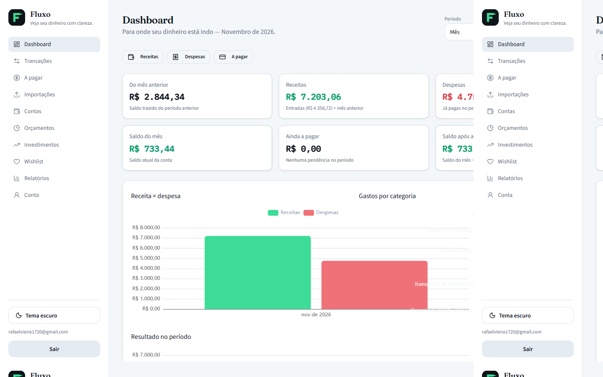
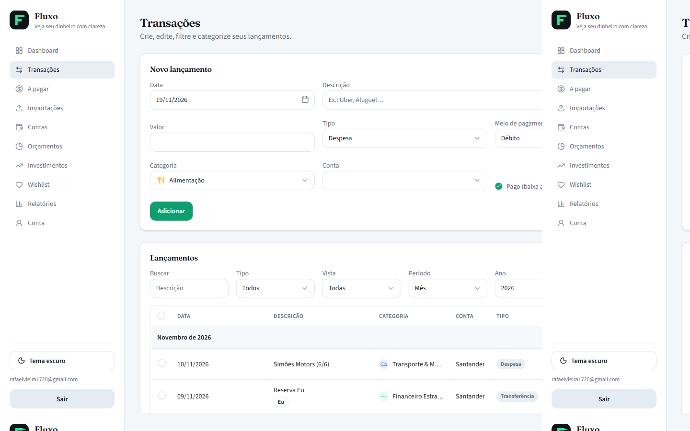
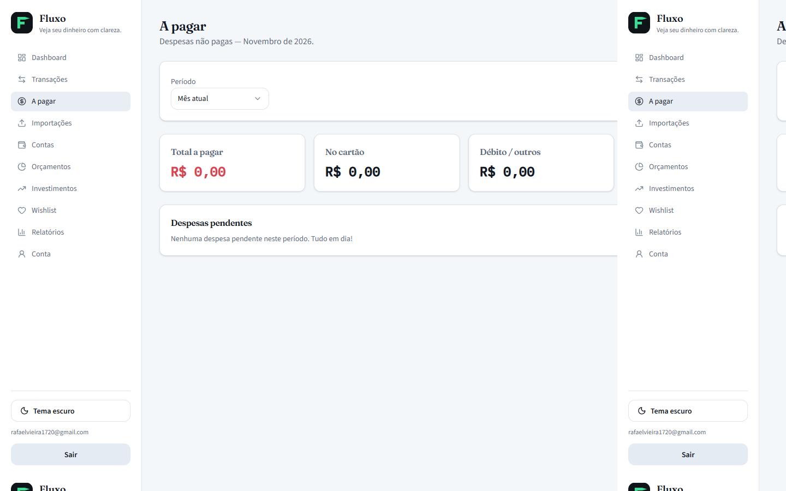
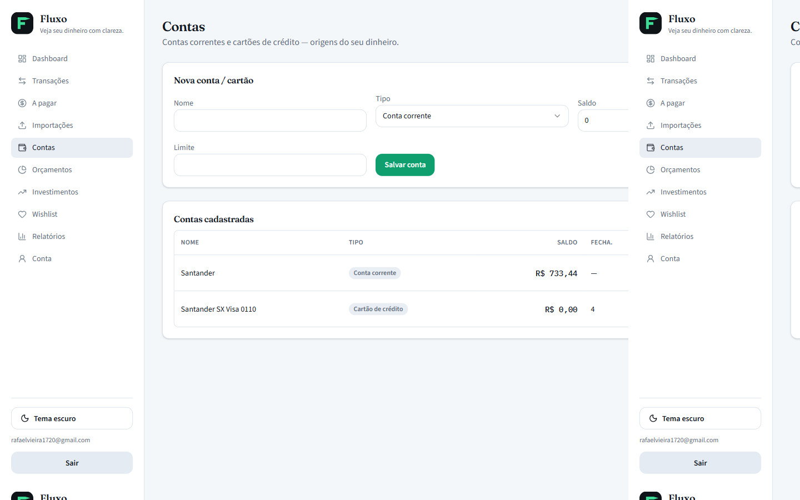
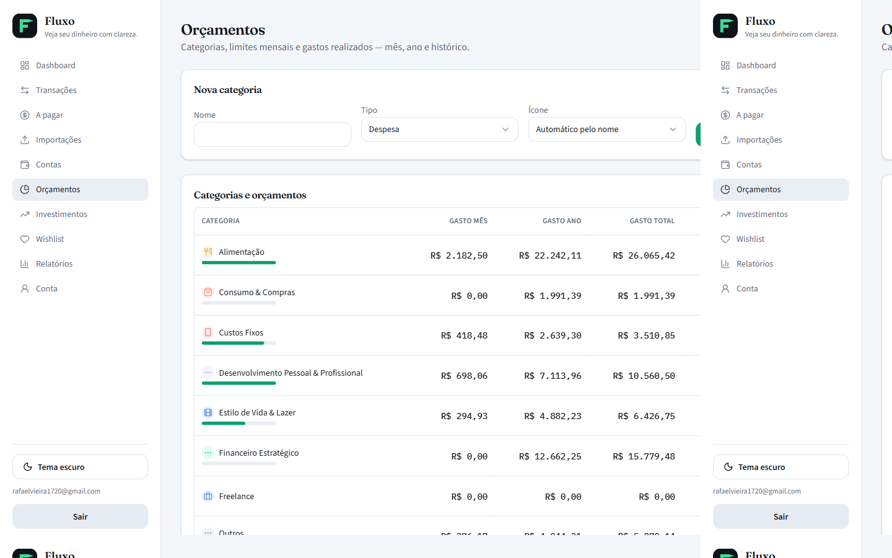
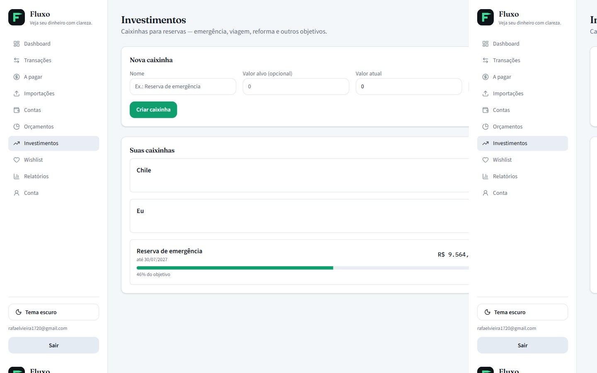
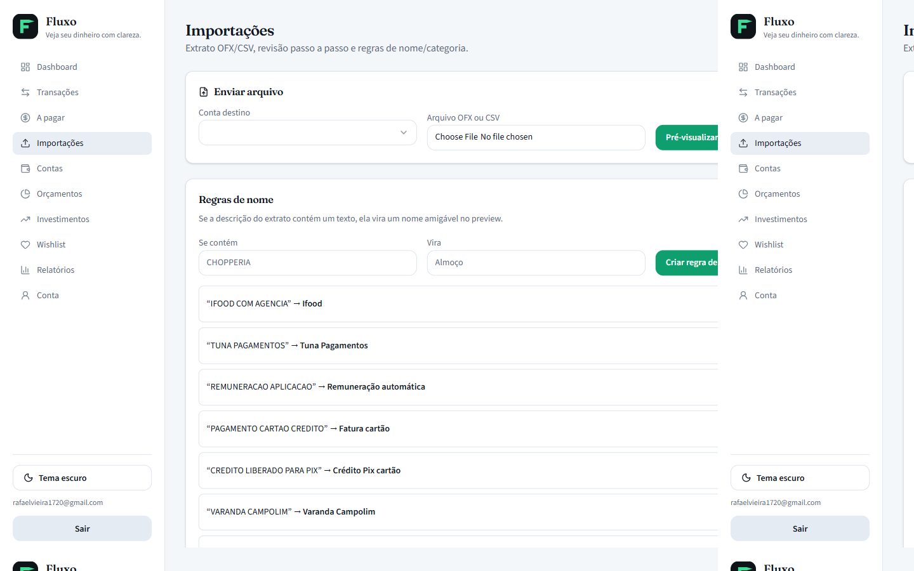
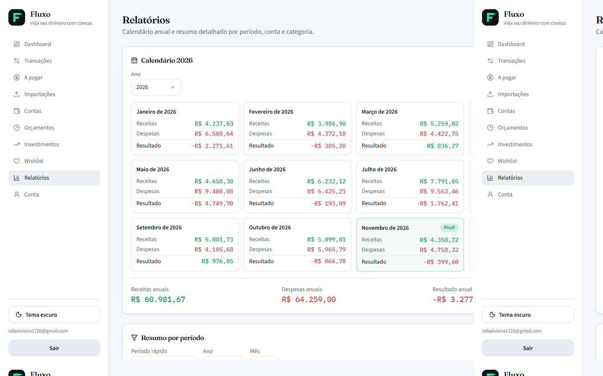
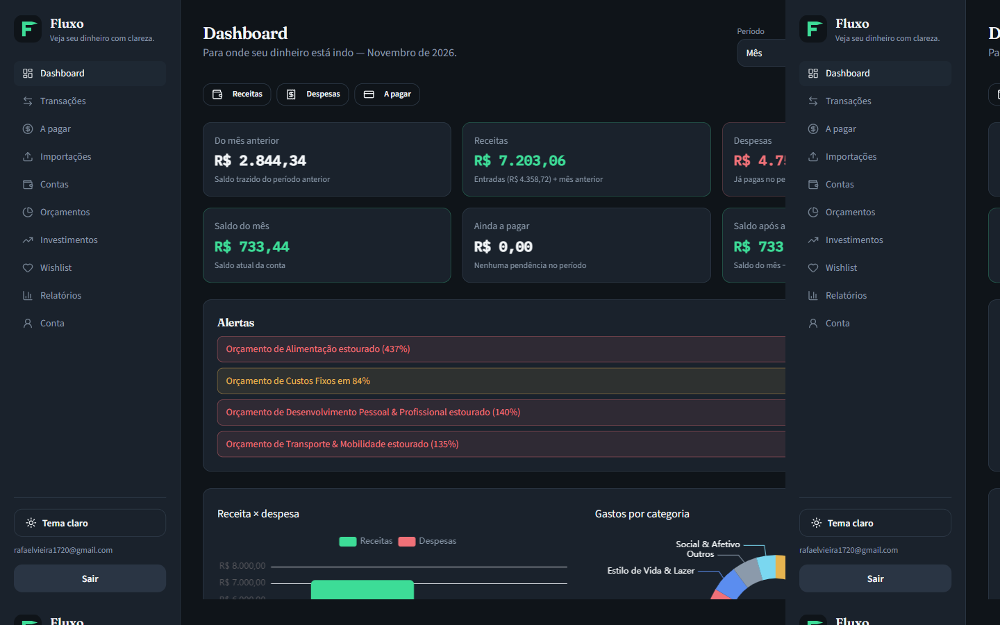

<p align="center">
  <strong>Fluxo</strong>
</p>

<p align="center">
  <strong>See your money clearly.</strong><br>
  Personal finance in BRL — dashboard, OFX and budgets in one place.
</p>

<p align="center">
  
  
  
  
  
</p>

<p align="center">
  <picture>
    <source media="(prefers-color-scheme: dark)" srcset="assets/screenshots/dashboard-escuro.png">
    
  </picture>
</p>

<p align="center">
  <a href="README.md">🇧🇷 Português</a> · 🇺🇸 English
</p>

## 🤔 The problem

Spreadsheets and generic apps do not match the bank statement or the card bill. At month-end you lack one view: where the money went and what is still due.

**Fluxo** anchors on the account balance, takes the OFX you already export, and joins entries, budgets and payables — without Open Finance.

## ✨ What only it guarantees

| | |
|---|---|
| 📊 **Month dashboard** | Income, expenses, carried balance and budget alerts in one panel. |
| 🏦 **OFX/CSV import** | Monthly statement (Santander and legacy), preview and friendly-name rules. |
| 💳 **Payables with settle** | Card dues; marking paid **moves** the paying account balance. |
| 🎯 **Budgets by category** | Limit, progress and alert when overspent. |
| 🔒 **Yours only** | Supabase Auth + RLS on `fluxo_*`; Express BFF. |

## 🧭 How it's used

1. **Sign in** at [fluxo.getvieira.com](https://fluxo.getvieira.com).
2. **Log** entries or **import** the statement; tune categories and budgets.
3. **Follow** the dashboard and payables until the month closes.

<details>
<summary><strong>📸 See the screens</strong></summary>
<br>

<table>
  <tr>
    <td width="50%"><a href="assets/screenshots/dashboard.png"></a><br><sub><b>Dashboard</b>: balance, income × expense and alerts</sub></td>
    <td width="50%"><a href="assets/screenshots/transacoes.png"></a><br><sub><b>Transactions</b>: new entry and filtered list</sub></td>
  </tr>
  <tr>
    <td width="50%"><a href="assets/screenshots/a-pagar.png"></a><br><sub><b>Payables</b>: dues for the period</sub></td>
    <td width="50%"><a href="assets/screenshots/contas.png"></a><br><sub><b>Accounts</b>: debit, card and anchor balance</sub></td>
  </tr>
  <tr>
    <td width="50%"><a href="assets/screenshots/orcamentos.png"></a><br><sub><b>Budgets</b>: categories, limits and spend</sub></td>
    <td width="50%"><a href="assets/screenshots/investimentos.png"></a><br><sub><b>Investments</b>: boxes with progress</sub></td>
  </tr>
  <tr>
    <td width="50%"><a href="assets/screenshots/importacoes.png"></a><br><sub><b>Imports</b>: OFX/CSV and name rules</sub></td>
    <td width="50%"><a href="assets/screenshots/relatorios.png"></a><br><sub><b>Reports</b>: aggregated period view</sub></td>
  </tr>
  <tr>
    <td width="50%"><a href="assets/screenshots/dashboard-escuro.png"></a><br><sub><b>Dark theme</b>: the same dashboard</sub></td>
    <td width="50%"></td>
  </tr>
</table>

</details>

## 🚀 Run it

**You need:** Node 22+, Yarn 1, PostgreSQL (Supabase) and the variables from the `.env.example` files (front and back).

```bash
yarn
cp frontend/.env.example frontend/.env
cp backend/.env.example backend/.env
# migrations in backend/migrations/ (001 → 007) in the SQL Editor
yarn dev
```

Front at http://localhost:3333 · API at http://localhost:3693. Details: [`docs/ambiente-e-operacao.md`](docs/ambiente-e-operacao.md).

## 🧰 Everyday commands

| Command | What for |
|---|---|
| `yarn dev` | Front (3333) and backend (3693) together |
| `cd backend && yarn test` | Backend tests |
| `cd frontend && yarn build` | Vite build |
| `cd backend && yarn build` | Express build |

## 📚 Documentation

| For | Read |
|---|---|
| Understand the project and find the right doc | [`docs/context.md`](docs/context.md) |
| What the product does today | [`docs/especificacao.md`](docs/especificacao.md) |
| Routes and shell | [`docs/frontend.md`](docs/frontend.md) |
| Auth and isolation | [`docs/seguranca.md`](docs/seguranca.md) |
| Run and publish | [`docs/ambiente-e-operacao.md`](docs/ambiente-e-operacao.md) |
| Visual | [`docs/DESIGN.md`](docs/DESIGN.md) |

## 🔐 Governance

- **Personal** use; private repository (`RafaelHDSV/Fluxo`).
- Production: [fluxo.getvieira.com](https://fluxo.getvieira.com).
- No lockup in `assets/logos/` yet — skill `logo` when its turn comes.
