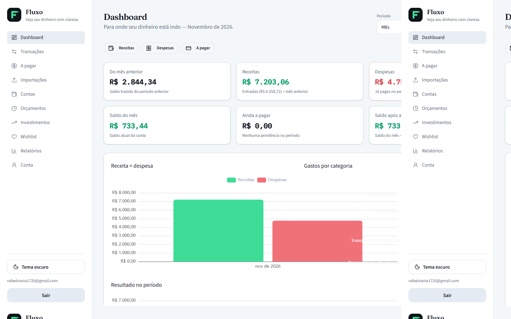
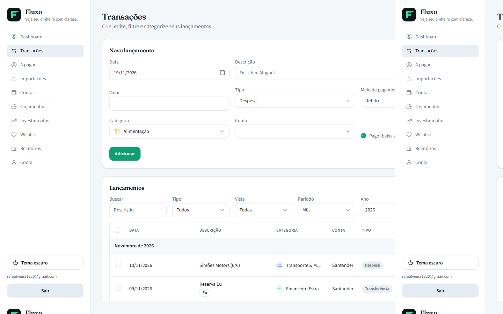
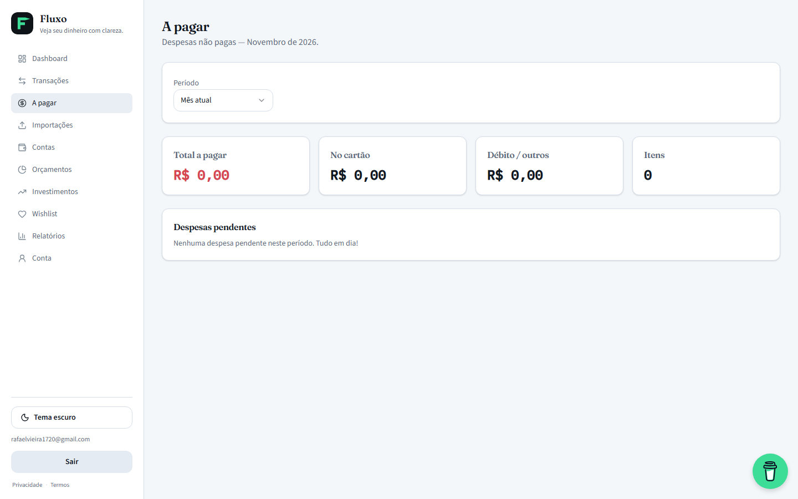
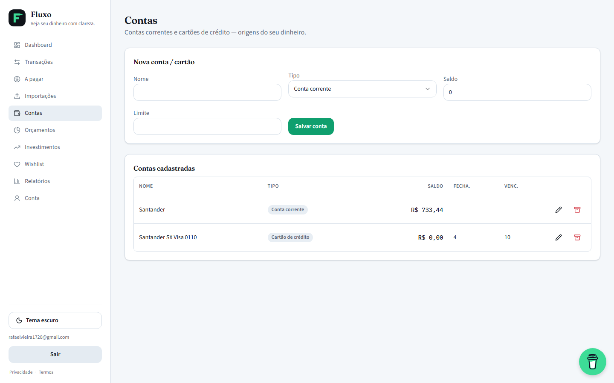
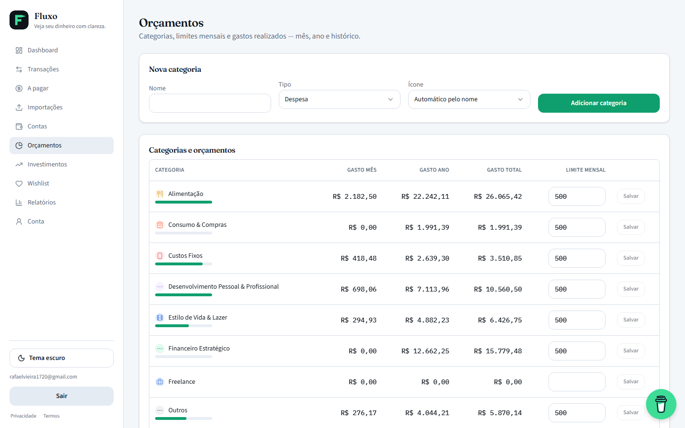
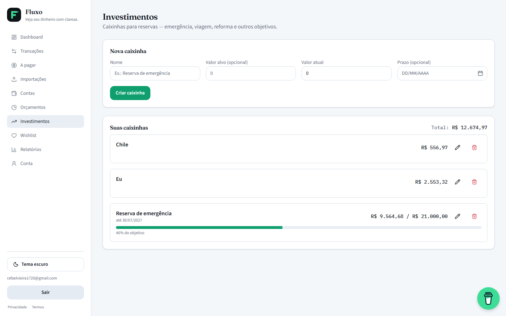
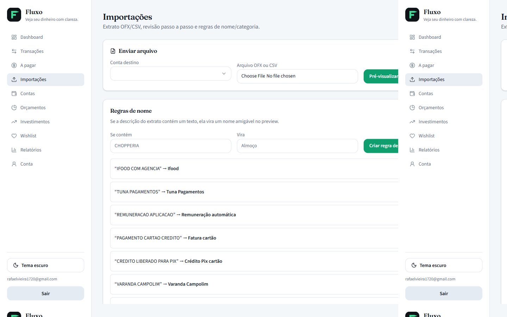
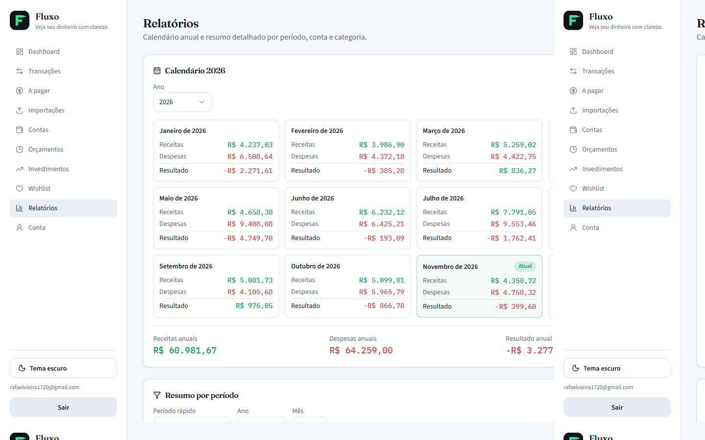
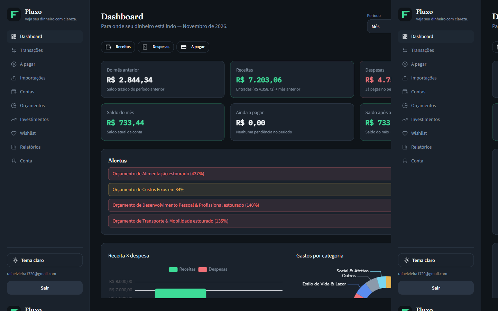

<p align="center">
  <strong>Fluxo</strong>
</p>

<p align="center">
  <strong>Veja seu dinheiro com clareza.</strong><br>
  Controle financeiro pessoal em BRL — dashboard, OFX e orçamentos no mesmo lugar.
</p>

<p align="center">
  
  
  
  
  
</p>

<p align="center">
  <picture>
    <source media="(prefers-color-scheme: dark)" srcset="assets/screenshots/dashboard-escuro.png">
    
  </picture>
</p>

<p align="center">
  🇧🇷 Português · <a href="README.en.md">🇺🇸 English</a>
</p>

## 🤔 O problema

Planilha e app genérico não batem com o extrato do banco nem com a fatura do cartão. No fim do mês falta uma visão única: para onde foi o dinheiro e o que ainda falta pagar.

**Fluxo** ancora no saldo da conta, aceita o OFX que você já exporta e junta lançamentos, orçamentos e a pagar — sem Open Finance.

## ✨ O que só ele garante

| | |
|---|---|
| 📊 **Dashboard do mês** | Receitas, despesas, saldo trazido e alertas de orçamento num painel só. |
| 🏦 **Importação OFX/CSV** | Extrato mensal (Santander e legado), preview e regras de nome amigável. |
| 💳 **A pagar com baixa** | Pendências de cartão; marcar pago **move** o saldo da conta. |
| 🎯 **Orçamentos por categoria** | Limite, progresso e alerta quando estoura. |
| 🔒 **Só seu** | Supabase Auth + RLS em `fluxo_*`; BFF Express. |

## 🧭 Como usar

1. **Entrar** em [fluxo.getvieira.com](https://fluxo.getvieira.com).
2. **Lançar** ou **importar** o extrato; ajustar categorias e orçamentos.
3. **Acompanhar** o dashboard e o a pagar até fechar o mês.

<details>
<summary><strong>📸 Ver as telas</strong></summary>
<br>

<table>
  <tr>
    <td width="50%"><a href="assets/screenshots/dashboard.png"></a><br><sub><b>Dashboard</b>: saldo, receita × despesa e alertas</sub></td>
    <td width="50%"><a href="assets/screenshots/transacoes.png"></a><br><sub><b>Transações</b>: novo lançamento e lista filtrada</sub></td>
  </tr>
  <tr>
    <td width="50%"><a href="assets/screenshots/a-pagar.png"></a><br><sub><b>A pagar</b>: pendências do período</sub></td>
    <td width="50%"><a href="assets/screenshots/contas.png"></a><br><sub><b>Contas</b>: débito, cartão e saldo âncora</sub></td>
  </tr>
  <tr>
    <td width="50%"><a href="assets/screenshots/orcamentos.png"></a><br><sub><b>Orçamentos</b>: categorias, limites e gasto</sub></td>
    <td width="50%"><a href="assets/screenshots/investimentos.png"></a><br><sub><b>Investimentos</b>: caixinhas com progresso</sub></td>
  </tr>
  <tr>
    <td width="50%"><a href="assets/screenshots/importacoes.png"></a><br><sub><b>Importações</b>: OFX/CSV e regras de nome</sub></td>
    <td width="50%"><a href="assets/screenshots/relatorios.png"></a><br><sub><b>Relatórios</b>: visão agregada do período</sub></td>
  </tr>
  <tr>
    <td width="50%"><a href="assets/screenshots/dashboard-escuro.png"></a><br><sub><b>Tema escuro</b>: o mesmo dashboard</sub></td>
    <td width="50%"></td>
  </tr>
</table>

</details>

## 🚀 Rodar

**Precisa de:** Node 22+, Yarn 1, PostgreSQL (Supabase) e as variáveis dos `.env.example` (front e back).

```bash
yarn
cp frontend/.env.example frontend/.env
cp backend/.env.example backend/.env
# migrations em backend/migrations/ (001 → 007) no SQL Editor
yarn dev
```

Front em http://localhost:3333 · API em http://localhost:3693. Detalhes: [`docs/ambiente-e-operacao.md`](docs/ambiente-e-operacao.md).

## 🧰 Comandos do dia a dia

| Comando | Para quê |
|---|---|
| `yarn dev` | Front (3333) e backend (3693) juntos |
| `cd backend && yarn test` | Testes do backend |
| `cd frontend && yarn build` | Build do Vite |
| `cd backend && yarn build` | Build do Express |

## 📚 Documentação

| Para | Leia |
|---|---|
| Entender o projeto e achar o documento certo | [`docs/context.md`](docs/context.md) |
| O que o produto faz hoje | [`docs/especificacao.md`](docs/especificacao.md) |
| Rotas e shell | [`docs/frontend.md`](docs/frontend.md) |
| Auth e isolamento | [`docs/seguranca.md`](docs/seguranca.md) |
| Rodar e publicar | [`docs/ambiente-e-operacao.md`](docs/ambiente-e-operacao.md) |
| Visual | [`docs/DESIGN.md`](docs/DESIGN.md) |

## 🔐 Governança

- Uso **pessoal**; repositório privado (`RafaelHDSV/Fluxo`).
- Produção: [fluxo.getvieira.com](https://fluxo.getvieira.com).
- Sem lockup em `assets/logos/` ainda — skill `logo` quando for a vez.
